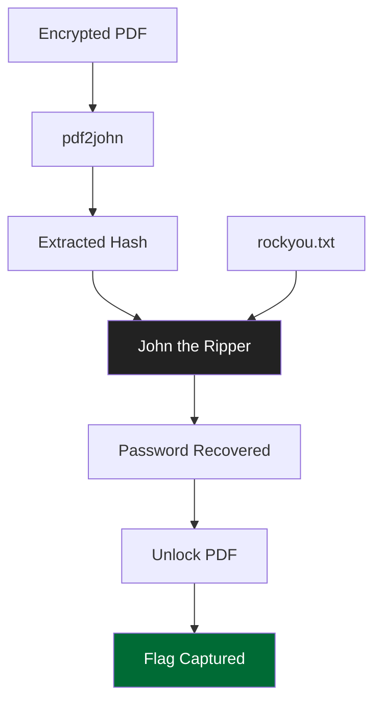

 <div align="center">

# 🔐 PASSWORD CRACKING & HASH ANALYSIS

### John the Ripper | PDF Password Recovery

**WEEK 03 — PROJECT MODULE 01**


**Performed by Hamza Riaz**

Cybersecurity Student | Ethical Hacking Enthusiast

**NETWORKWALKS** | Batch: **B084**  
**Instructor:** WAQAS KARIM, CCIE

</div>

---

## 🟢 01. Mission Overview

This project demonstrates practical PDF password hash extraction and offline dictionary-based password cracking using **John the Ripper** on Kali Linux.

**Objective:** Extract the password hash from an encrypted PDF, perform a dictionary attack, recover the password, and unlock the protected document to capture the flag.

| Mission Details | Information |
|---|---|
| Target | `My Locked PDF1.pdf` |
| Operating System | Kali Linux |
| Hash Extractor | pdf2john |
| Cracking Tool | John the Ripper |
| Wordlist | rockyou.txt |
| Attack Type | Dictionary Attack |
| Result | First Flag Captured |

## ⚡ 02. Attack Workflow



## 🛠️ 03. Tools & Technologies

| Tool | Purpose |
|---|---|
| Kali Linux | Penetration testing environment |
| pdf2john | PDF hash extraction |
| John the Ripper | Password cracking |
| rockyou.txt | Dictionary wordlist |

## 💻 04. Practical Execution

### Step 01 — Hash Extraction

Extracted the password hash from the encrypted PDF.

```bash
pdf2john "My Locked PDF1.pdf" > hash1.txt
```

### Step 02 — Wordlist Preparation

Decompressed the RockYou wordlist.

```bash
sudo gzip -d /usr/share/wordlists/rockyou.txt.gz
```

### Step 03 — Dictionary Attack

Executed John the Ripper against the extracted hash.

```bash
john --wordlist=/usr/share/wordlists/rockyou.txt hash1.txt
```

### Step 04 — Password Recovery

Retrieved the recovered password.

```bash
john --show hash1.txt
```

### Step 05 — PDF Decryption

Used the recovered password to unlock the encrypted PDF and verify the flag.

<badge color="success">MISSION COMPLETED — FLAG 01 CAPTURED</badge>

## 📸 05. Evidence & Screenshots

| Terminal — Password Cracking | PDF — Flag Confirmation |
|---|---|
|  |  |

## 🛡️ 06. Security Analysis

**Key Learnings**

- Understanding PDF password protection and hash extraction.
- Learning how offline dictionary attacks work.
- Using John the Ripper for password auditing.
- Understanding the risks of weak and predictable passwords.
- Applying stronger password practices and modern encryption.

**Defensive Recommendations**

- Use long and unique passwords.
- Avoid dictionary-based and predictable passwords.
- Use trusted password managers.
- Apply strong PDF encryption configurations such as AES-256.

## ⚠️ 07. Ethical Disclaimer

This project was performed strictly for educational and defensive cybersecurity learning purposes as part of the authorized **NETWORKWALKS** training program.

All activities were conducted in a controlled lab environment. Never attempt password cracking on files or systems without explicit authorization.

---

<div align="center">

### 👨‍💻 HAMZA RIAZ

**CYBERSECURITY | ETHICAL HACKING | PENETRATION TESTING**

`NETWORKWALKS` • `BATCH B084` • `WEEK 03`

*Learn. Practice. Analyze. Secure.*

</div>
